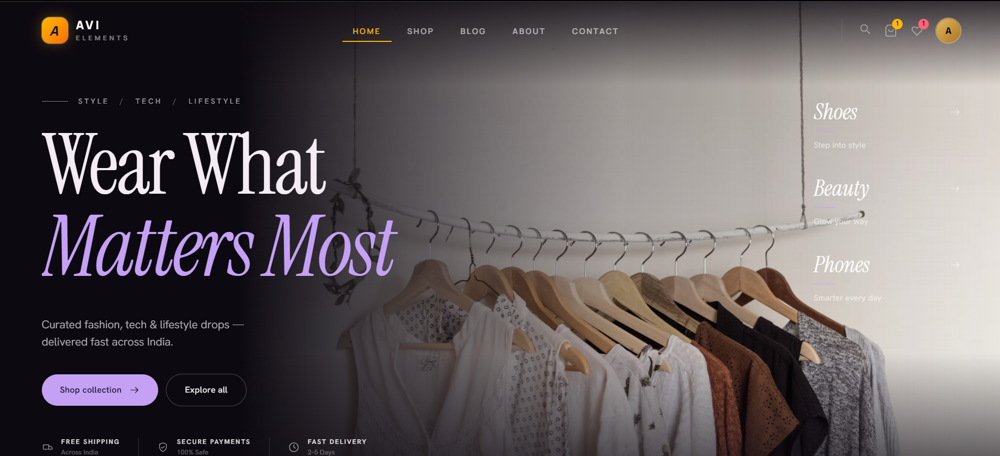

# AVI-EC



AVI-EC is a responsive e-commerce storefront built with React and Vite. It includes a product catalog, account-based shopping features, and supporting blog and information pages.

## Features

- Browse products, view product details, search and filter the catalog by category, sort results, and paginate.
- Add products to a cart or wishlist. Cart and wishlist data are stored in the browser and kept separate for guest and signed-in users.
- Sign up and sign in with email and password or Google using Firebase Authentication, and request a password reset.
- Use protected cart, checkout, order, and profile pages after signing in.
- Explore the blog, About, and Contact pages.
- Responsive layouts with animated UI elements and mobile navigation.

> **Demo checkout:** Orders and profile-related data are stored in browser `localStorage`. This project does not connect to a payment processor or a server-side order database.

## Tech stack

- React 19 and Vite 7
- React Router
- Redux Toolkit and React Redux
- Firebase Authentication
- Tailwind CSS 4
- Framer Motion and Swiper

## Getting started

### Prerequisites

- Node.js and npm
- A Firebase project with Authentication enabled

### Install and configure

1. Install dependencies:

   ```bash
   npm install
   ```

2. Create a `.env.local` file in the repository root and add your Firebase web app configuration:

   ```dotenv
   VITE_APIKEY=your_firebase_api_key
   VITE_AUTHDOMAIN=your_firebase_auth_domain
   VITE_PROJECTID=your_firebase_project_id
   VITE_STORAGEBUCKET=your_firebase_storage_bucket
   VITE_MESSAGINGSENDERID=your_firebase_messaging_sender_id
   VITE_APPID=your_firebase_app_id
   ```

   Enable the Email/Password and Google sign-in providers in the Firebase Console. Do not commit real credentials or local environment files.

3. Start the Vite development server:

   ```bash
   npm run start
   ```

   Vite prints the local URL in the terminal.

## Available scripts

| Command | Description |
| --- | --- |
| `npm run start` | Start the development server |
| `npm run build` | Create a production build in `dist/` |
| `npm run preview` | Preview the production build locally |
| `npm run lint` | Run ESLint |

## Project layout

```text
src/
  Blog/         Blog listing and article pages
  Contact/      Contact page
  Home/         Home page sections
  Shop/         Catalog, product, cart, checkout, and account pages
  components/   Shared UI components
  context/      Firebase authentication context
  firebase/     Firebase app configuration
  utilis/       Redux store, slices, and browser persistence helpers
  products.json Local product catalog data
  App.jsx       Shared application layout
  main.jsx      Router and application entry point
screenshots/    Project screenshots
```

## Product data

The storefront catalog is defined in [`src/products.json`](src/products.json). Update that file to change the products displayed in the shop.

## Deployment

Build the app with `npm run build` before deploying. The repository includes Vercel rewrite configuration in `vercel.json` and Firebase Hosting configuration in `firebase.json`; Firebase Hosting serves the generated `dist/` directory and rewrites application routes to `index.html`.
